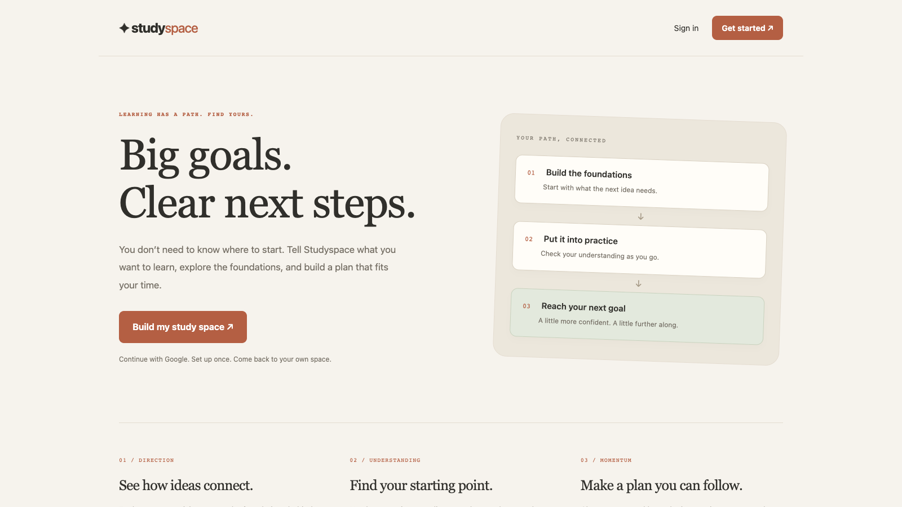
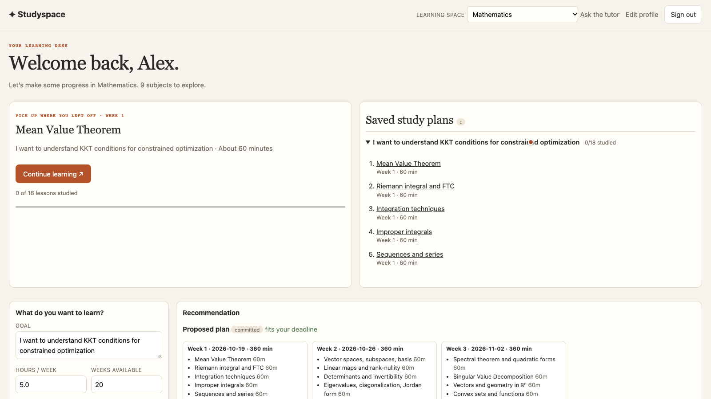
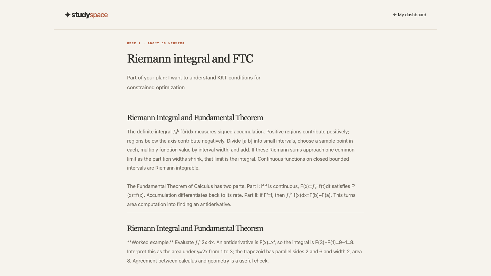
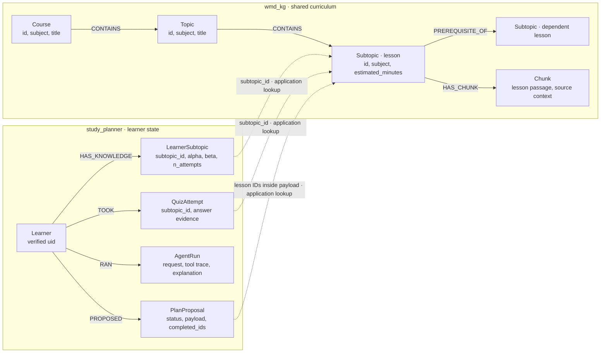
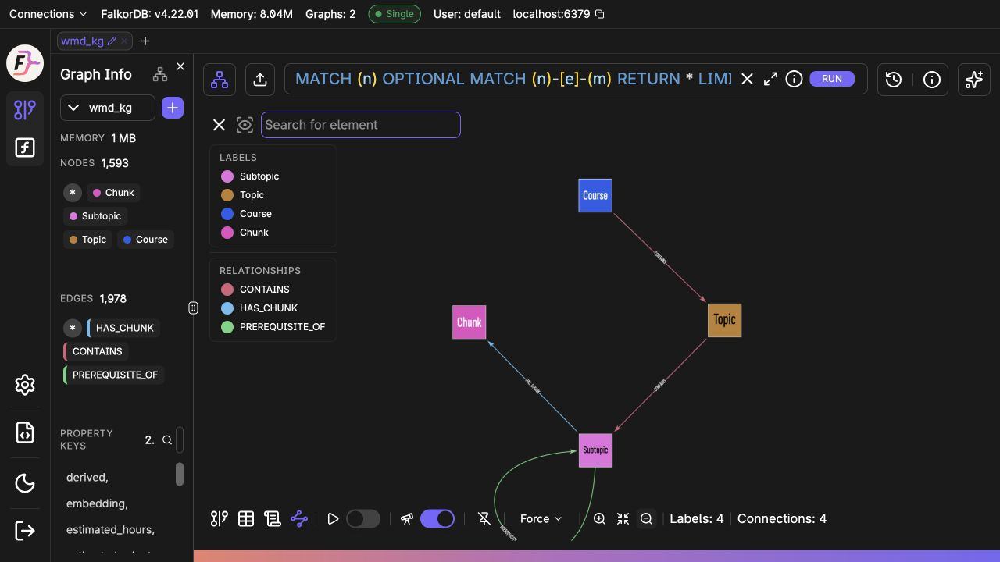
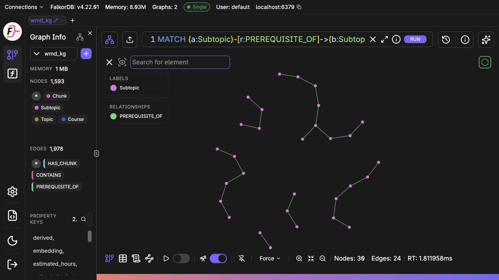
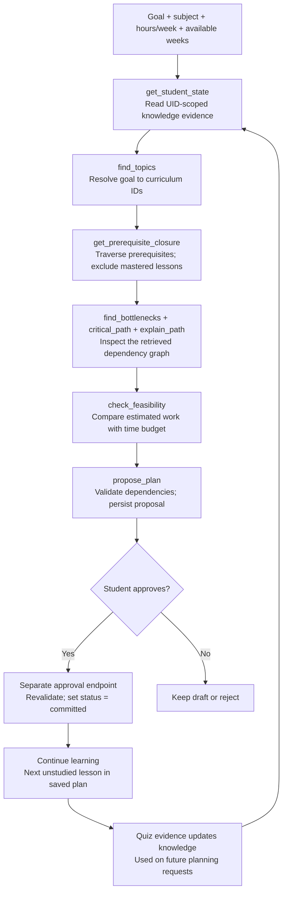

# Studyspace — graph-powered study planner

An explainable study planner built with FastAPI and FalkorDB for **Track 01: Agents That Act on Connected Data**. Nine subjects are loaded from `artifacts/` (mathematics plus eight flat-structure subjects; see the subject notes below). Graph traversal finds the learner's prerequisite gaps and linked resources; optional AI selects and orders only among those retrieved candidates, then the backend validates its selection before saving the plan.

## Screenshots

| Landing page | Agent reasoning and prerequisite map |
|---|---|
|  |  |

| Saved study plan | Lesson view |
|---|---|
|  |  |
## Map of the graph: how FalkorDB powers Studyspace

Studyspace enters **Agents That Act on Connected Data**. The `/agent` workflow uses two named FalkorDB graphs: shared curriculum in `wmd_kg`, and private learner/planning state in `study_planner` (configurable with `FALKORDB_GRAPH`). The diagrams below match the loader and agent code, checked against the running local database on October 18, 2026.

### Nodes and relationships



**Solid arrows are stored relationships. Dotted arrows are application lookups by lesson ID across the two graphs; they are not cross-graph FalkorDB edges.** Weekly plan items are stored inside `PlanProposal.payload`; studying a lesson updates `completed_ids`. Approval changes the proposal status from `proposed` to `committed`, rather than creating an extra approval relationship.

| Graph | Nodes / relationships | What they contribute |
| --- | --- | --- |
| `wmd_kg` | `Course → CONTAINS → Topic → CONTAINS → Subtopic` | Subject-scoped curriculum hierarchy and lesson metadata. |
| `wmd_kg` | `Subtopic → PREREQUISITE_OF → Subtopic` | Multi-hop prerequisite retrieval, dependency ordering, gatekeepers, and critical-path context. Edges carry `strength`, `status`, `scope`, and `derived`. |
| `wmd_kg` | `Subtopic → HAS_CHUNK → Chunk` | Lesson passages for reading and source-grounded tutor retrieval. |
| `study_planner` | `Learner → HAS_KNOWLEDGE → LearnerSubtopic` | Per-learner evidence used to estimate mastery and skip known foundations. |
| `study_planner` | `Learner → TOOK → QuizAttempt` | Persistent quiz activity associated with a lesson. |
| `study_planner` | `Learner → RAN → AgentRun` | Inspectable tool traces and explanations. |
| `study_planner` | `Learner → PROPOSED → PlanProposal` | Drafts, student-approved plans, and saved reading progress. |

The local curriculum snapshot contains **9 courses, 108 topics, 350 subtopics, 394 prerequisite relationships, and 1,126 lesson chunks**. Counts can change when curriculum files are edited and reloaded. Authentication uses Firebase; learner queries use the verified UID. Profiles also use FalkorDB by default, with an explicitly configured Firestore option.

### Screenshots from the running FalkorDB Browser

These are unaltered captures from [localhost:3000](http://localhost:3000), using the real `wmd_kg` curriculum graph.



*Schema view shows the four stored curriculum labels and their relationships. The left panel reports the full graph: 1,593 nodes and 1,978 edges, including 394 prerequisite edges.*



*Graph view displays 24 mathematics prerequisite relationships connecting 30 distinct lesson nodes. This is a limited query result, not the complete curriculum. The query used is:*

```cypher
MATCH (a:Subtopic)-[r:PREREQUISITE_OF]->(b:Subtopic)
WHERE a.subject = 'mathematics'
RETURN a, r, b LIMIT 24
```

### How the agent queries the graph



Both the optional Gemini tool-calling controller and the deterministic playbook use the same [agent tools](app/agent/tools.py). The diagram follows the playbook's main planning path; quiz assignment may add checkpoint tools. `commit_plan` is deliberately excluded from the tools offered to the agent. The student approves through a separate endpoint.

#### 1. Retrieve learner evidence (`study_planner`)

```cypher
MATCH (:Learner {uid:$uid})-[:HAS_KNOWLEDGE]->(k:LearnerSubtopic)
RETURN k.subtopic_id, k.alpha, k.beta, k.updated_ms,
       k.n_attempts, k.inferred
```

The backend computes decayed mastery estimates from this evidence and supplies the mastered lesson IDs to curriculum retrieval. Reading completion is separate from quiz-based mastery.

#### 2. Find unresolved prerequisites (`wmd_kg`)

This is the core traversal used when soft prerequisites are included; relationship filters are expanded here for readability:

```cypher
MATCH (t:Subtopic)
WHERE t.id IN $targets
MATCH p=(pre:Subtopic)-[:PREREQUISITE_OF*1..20]->(t)
WHERE NOT pre.id IN $mastered
  AND all(r IN relationships(p)
    WHERE r.status IN ['curated','approved']
      AND coalesce(r.scope,'') <> 'course')
  AND all(n IN nodes(p)[1..size(nodes(p))-1]
    WHERE NOT n.id IN $mastered)
RETURN DISTINCT pre.id, pre.title, pre.estimated_minutes,
                pre.topic_order, pre.order
```

The application also adds each unmastered target itself. A mastered intermediate lesson cuts traversal along that path; this is an explicit prototype assumption. Inputs are bound parameters. For a goal such as **KKT conditions**, the retrieved context spans the connected calculus, linear algebra, and optimization foundations required by the curriculum.

#### 3. Inspect a dependency path (`wmd_kg`)

```cypher
MATCH (a:Subtopic {id:$a}), (b:Subtopic {id:$b})
WITH shortestPath((a)-[:PREREQUISITE_OF*]->(b)) AS p
RETURN [n IN nodes(p) | n.id]
```

Path explanation also has a Python BFS fallback. Gatekeeper ranking calls FalkorDB's native betweenness algorithm, then restricts results to the required lessons:

```cypher
CALL algo.betweenness({nodeLabels:['Subtopic'], relationshipTypes:['PREREQUISITE_OF']})
YIELD node, score
RETURN node.id, node.title, score ORDER BY score DESC
```

If the selected lessons receive no positive scores, the application computes betweenness over their induced subgraph as a fallback. Dependency ordering (Kahn's algorithm) and duration-weighted critical-path calculations run in Python over graph data retrieved from FalkorDB; feasibility compares total estimated work with the study budget.

#### 4. Resume an approved plan (`study_planner`)

```cypher
MATCH (p:PlanProposal {uid:$uid, status:'committed'})
RETURN p.id, p.payload, p.completed_ids, p.committed_ms
ORDER BY p.committed_ms DESC, p.id
```

The backend selects the first unstudied lesson in the latest unfinished approved plan. Repeated completion clicks are idempotent. New quiz evidence affects future planning requests; existing approved plans are not silently rewritten.

**Implementation:** [loader](app/kg/loader.py) · [Cypher and graph algorithms](app/kg/queries.py) · [agent tools](app/agent/tools.py) · [controllers](app/agent/controllers.py) · [learner evidence](app/learn/state.py) · [saved plans](app/learn/plans.py).

**Inspect locally:** open the FalkorDB Browser at [localhost:3000](http://localhost:3000), connect to the local database on port `6379` using your deployment credentials, and choose `wmd_kg`. These read-only queries show the stored curriculum and a small prerequisite neighborhood:

```cypher
MATCH (n) RETURN labels(n), count(n)
```

```cypher
MATCH (a:Subtopic)-[r:PREREQUISITE_OF]->(b:Subtopic)
WHERE a.subject = 'mathematics'
RETURN a, r, b LIMIT 30
```

Select `study_planner` separately to inspect learner-state labels and relationships. Avoid sharing personal learner properties or credentials in public screenshots.


## Run locally

Requirements: Python 3.11+ and Docker Compose.

```sh
cp .env.example .env
docker compose up -d falkordb
python -m venv .venv
source .venv/bin/activate
pip install -e .
uvicorn app.main:app --reload
```

Open [http://localhost:8000](http://localhost:8000). Local mode uses a clearly labeled demo learner. Check `http://localhost:8000/health` to see whether FalkorDB is reachable. Course seeding runs idempotently when the planner opens.

## API

The JSON API is versioned under `/api/v1` and uses the same signed-in learner as the web UI. In demo mode, sign in at `/login` first; the `study_session` cookie is used for API requests too. Open `/docs` for the interactive OpenAPI reference. Run the backend tests with `python -m unittest discover -s tests -v`.

```sh
curl http://localhost:8000/api/v1/health
curl -c cookies.txt -X POST http://localhost:8000/auth/demo
curl -b cookies.txt http://localhost:8000/api/v1/courses/foundational_math
curl -b cookies.txt http://localhost:8000/api/v1/plan
curl -b cookies.txt -X POST http://localhost:8000/api/v1/plan/generate
curl -b cookies.txt http://localhost:8000/api/v1/topics/limits/assessment
curl -b cookies.txt -H 'Content-Type: application/json' \
  -d '{"assessment_id":"quick_check_limits","answer":"B"}' \
  -X POST http://localhost:8000/api/v1/assessments/submit
curl -b cookies.txt -H 'Content-Type: application/json' \
  -d '{"exam_date":"2099-12-01","minutes_per_day":45,"exam_topic":"derivatives"}' \
  -X PUT http://localhost:8000/api/v1/plan/preferences
curl -b cookies.txt -H 'Content-Type: application/json' \
  -d '{"topic_id":"limits","score":3,"max_score":5}' \
  -X POST http://localhost:8000/api/v1/attempts
curl -b cookies.txt -H 'Content-Type: application/json' \
  -d '{"topic_id":"limits"}' \
  -X POST http://localhost:8000/api/v1/sessions/complete
```

Routes return JSON errors (`401` when signed out, `404` for unknown courses/topics, `422` for invalid input, and `503` when FalkorDB cannot be reached). API code is in `app/api/`, server-rendered routes are in `app/ui/`, and `app/ai/` contains the optional LiteLLM integration. When enabled, AI may select and order retrieved candidate topics; the backend validates every proposal against graph candidates and prerequisite order.

## Google Gemini through LiteLLM

The roadmap endpoint makes a real LiteLLM chat-completion request when AI is enabled. LiteLLM routes Gemini API calls with the `gemini/` model prefix and reads `GEMINI_API_KEY`. Model selection and fallbacks are in the root `llm_config.json`: primary `gemini-3.8-flash`, then `gemini-3.6-flash`, then `gemini-3.5-flash-lite`. Check Google's current model availability for your account before changing model IDs. An `AI_MODEL` value in `.env` overrides the configured primary; `AI_FALLBACK_MODELS` can override the fallback list as a comma-separated list.

1. Create a Gemini API key in [Google AI Studio](https://aistudio.google.com/app/apikey).
2. Install the optional LiteLLM dependency: `pip install -e '.[llm]'`.
3. Put the key in your local `.env` as `GEMINI_API_KEY=...`. Do not commit or paste the key into source code.
4. Set `AI_ENABLED=true` in `.env`, leave `AI_MODEL` blank to use `llm_config.json`, then restart `uvicorn`.
5. Sign in and request a plan. This call invokes Gemini when the cache has no matching graph context:

```sh
curl -b cookies.txt -X POST http://localhost:8000/api/v1/plan/generate
```

Inspect `plan_selection` in the JSON response. `graph_context_ai` means the model proposal passed backend validation; `graph_ranked_fallback` means the graph-ranked plan was used (AI disabled, provider error, invalid model output, or a proposal that failed validation). `ai_summary` is the model's short explanation when accepted. The LLM receives only graph-retrieved candidate facts and cannot invent topics, dependencies, mastery, or references. Plan generation persists the accepted plan in FalkorDB.

Gemini 3 models have model-specific sampling behavior; this integration leaves `temperature` unset rather than forcing a low value. Each model request is capped at 200 output tokens, times out after `AI_TIMEOUT_SECONDS`, and makes no internal retries; if a request fails or returns unusable JSON, the next model in the configured list is called. Accepted proposals are cached in-process by graph context. See [LiteLLM's Gemini provider guide](https://docs.litellm.ai/docs/providers/gemini) and [Google's Gemini model list](https://ai.google.dev/gemini-api/docs/models) for current model IDs and provider behavior.

## Foundational API graph model (separate from the study agent)

The older `/api/v1` foundational-math flow also uses `study_planner`, with `LearnerTopic`, `StudyPlan`, `PlanItem`, and resource/assessment relationships. The diagram below describes that separate API model; the current `/agent` graph map and query flow are documented above. In this foundational model:

```text
(Course)-[:CONTAINS]->(Topic)-[:PREREQUISITE_OF]->(Topic)
(Resource)-[:TEACHES]->(Topic)       (Assessment)-[:CHECKS]->(Topic)
(Learner)-[:MADE_ATTEMPT]->(Attempt)-[:ABOUT]->(Topic)
(Learner)-[:HAS_SESSION]->(StudySession)-[:FOCUSES_ON]->(Topic)
(Learner)-[:HAS_KNOWLEDGE]->(LearnerTopic)-[:ABOUT]->(Topic)
(Learner)-[:HAS_PLAN]->(StudyPlan)-[:INCLUDES]->(PlanItem)-[:FOCUSES_ON]->(Topic)
(PlanItem)-[:USES]->(Resource)
```

`app/graph/repository.py` owns Cypher and converts driver rows into application data. Query inputs such as course IDs, learner UIDs, topic IDs, scores, and status values are bound as Cypher parameters; only fixed labels, relationship types, and query structure remain in the query text. The API and UI call repository methods instead of running Cypher themselves.

Assessment submission records an `Attempt` and updates compact per-learner/per-topic `LearnerTopic` evidence (running average, count, timestamp). The assessment answer key stays server-side. FalkorDB traverses prerequisite paths to the selected exam topic and removes topics whose recorded average is at least 70%. With AI enabled, LiteLLM selects and orders up to three topics from the remaining graph-retrieved candidates. The backend rejects unknown topic IDs or ordering that violates an unresolved prerequisite and falls back to graph order. It then persists a `StudyPlan` and `PlanItem` graph, superseding the prior active plan. AI receives only the compact candidate set and can write a short summary; it cannot change scores or resource citations. This is a hackathon prototype: the 70% threshold is not a validated mastery model, and exam-date scheduling and general-purpose optimization remain future work.

The first page lets you choose an exam goal (quadratics, limits, or derivatives), save an exam date and daily study time, review graph-backed recommendations, mark a study session complete, and record checks for recommended topics. API clients can fetch a targeted, seeded diagnostic question and submit its answer; the resulting evidence changes later recommendations. The goal selects which prerequisite paths FalkorDB traverses. The demo learner data is stored in FalkorDB and remains until you reset it in the app or remove the volume with `docker compose down -v`.

## Google sign-in setup

Google sign-in uses Firebase Authentication. New users complete a profile once (full name, preferred name, optional phone, role, industry, and learning interest); returning users go directly to their personalized dashboard. `/` is the public landing page, `/login` and `/signup` use the same Google identity flow, and `/onboarding?edit=1` edits an existing profile.

Set `AUTH_MODE=firebase` and the Firebase web configuration in `.env`. Enable Google's sign-in provider and authorize the local/deployed domain in Firebase. The server verifies the Google ID token before setting a five-day HttpOnly session. Local development uses a signed app cookie, avoiding Firebase's session-cookie quota-project requirement. Production uses Firebase Admin session cookies with revocation checks; configure Admin credentials, `APP_ENV=production`, a strong `SESSION_SECRET`, and `SESSION_COOKIE_SECURE=true`.

Account profiles use the existing FalkorDB by default (`PROFILE_STORE=falkordb`), keyed by verified Firebase UID. This does not require a separate Firestore database or Google Cloud billing setup. To use Firestore instead, create its default database, grant the server credentials access, and explicitly set `PROFILE_STORE=firestore`. Storage never switches automatically. Never commit credentials.

Authentication regression tests: `AUTH_MODE=demo AI_ENABLED=false .venv/bin/python -m pytest tests/test_auth_onboarding.py tests/test_http.py tests/test_tutor.py -q`. `tests/browser_auth.cjs` runs the full browser flow with Google OAuth mocked and real local FalkorDB; it requires Node, Playwright, and installed Chrome. It cleans up its synthetic account afterward.

## Current scope

- One hand-authored, 12-topic course and a short list of source-linked resources.
- FalkorDB stores course topics, prerequisite relationships, resources, targeted checks, learner evidence, and persisted plans.
- Graph retrieval and knowledge updates are deterministic; optional LiteLLM may select and order graph candidates. Configure Gemini as described above. The graph-validated fallback remains available if the provider is unavailable.
- Local demo authentication is not suitable for a public deployment. Firebase ID-token verification is enabled when `AUTH_MODE=firebase`.

## Study agent (hackathon slice)

- Load every subject under `artifacts/` into `wmd_kg`: `python -m app.kg.loader` (also runs idempotently at app start; `--root artifacts/physics` loads one subject, `--dry-run` only parses and prints data-quality facts).
- No Docker and Python 3.12+? `pip install -e ".[embedded]"` then `python scripts/run_embedded.py`, sign in with demo auth, open `/agent`.
- Agent: `app/agent` (deterministic playbook, plus LLM tool-calling when `AI_ENABLED=true`, falling back to the playbook on any failure or ungrounded output). Plans are proposals; only the approve endpoint commits.
- MCP server (stdio, demo uid from `MCP_UID`): `python -m app.mcp_server.server`.
- Question banks: `question_bank/<subject>/*.yaml` (858 questions across 283 lesson banks); tests: `python -m pytest` (uses embedded FalkorDB on 3.12+, otherwise Docker FalkorDB on localhost:6379).

## Tutor (GraphRAG Q&A)

- `/tutor`: ask a question in the selected subject; answers come only from the lesson text (boilerplate template chunks are dropped at load; chunks linked to subtopics via `HAS_CHUNK`), retrieved with BM25, optionally fused with embeddings (`EMBEDDING_MODEL=gemini/text-embedding-004 python -m app.rag.embed`), then expanded over the prerequisite graph.
- Personalized: level comes from quiz mastery on the topic, else from onboarding; prerequisites you have not mastered are flagged with quiz links. Self-reported known topics are provisional until a quiz confirms them.
- With `AI_ENABLED=true` an LLM writes the answer from the retrieved passages and must cite `[n]`; otherwise, or if it cites anything else, the app shows extractive lesson text with sources. Off-corpus questions are declined, not guessed.

## Subjects and data quality

Every node carries a `subject` property (the folder name) and ids are globally unique (`math-…`, `physics-…`). The UI, agent (`AgentRequest.subject`), MCP server (`MCP_SUBJECT`) and tutor are subject-scoped; no edges cross subjects.

Mathematics retains its 84 lessons and 92 authored prerequisite links. The other eight subjects now have 266 concept-sized lessons and 302 authored prerequisite links, plus a quiz bank for every lesson. Lessons use the supplied topic scopes, topic-specific explanations, and subject-specific worked-study guidance; the seed questions check scope knowledge and sound subject methods. Their breadth and depth still vary by topic and should be reviewed before use as a formal course. Curriculum files are fingerprinted at startup, so edits trigger an idempotent refresh of that subject's graph nodes, edges, and lesson chunks. Repeated boilerplate chunks are not indexed.

### Saved plans and continuing lessons

Approved agent proposals appear in the dashboard's saved plans section. “Continue learning” opens the first unstudied lesson in the most recently approved unfinished plan. Each lesson shows the course passages, an optional quiz link, and “Mark as studied.” Completion is persisted per user and plan, survives later visits, and is idempotent. Studied lessons do not automatically count as mastered; quizzes continue to provide mastery evidence. Draft and rejected proposals are excluded. Regression coverage lives in `tests/test_saved_plans.py` and `tests/browser_auth.cjs`.
