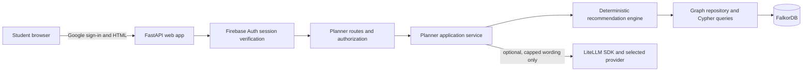

# ADR 003: Study planner HLD and LLD

**Status:** Proposed — product-owner direction captured; provider and course decisions pending  
**Date:** 2026-10-15  
**Related:** [Study planner PRD](adr_002_prd-study-planner.md)

> This is a design proposal, not an implementation contract yet. I have included my recommendation and the trade-offs so we can agree on the decisions before coding. Once we confirm the open choices, update the status to **Accepted** and treat the selected design as the team's working agreement.

## 1. Decision to make

How should we structure and implement the hackathon study planner so we can finish a useful, reviewable MVP quickly, keep FalkorDB central to the recommendation, and still leave a sensible path to a real multi-user product?

## 2. Decision drivers

1. A student can set up a plan, receive a graph-backed next step, record progress, and see the recommendation change.
2. FalkorDB is the system of record for course relationships and learner evidence; it is not a decorative visualization store.
3. Recommendation logic is deterministic and inspectable. An LLM must not create prerequisite facts or assessment results.
4. The full happy path can be built and rehearsed within the hackathon window.
5. Keep technology choices explainable to every team member and easy to run locally.
6. Do not expose one learner's records to another learner when moving beyond the seeded demo.

## 3. Proposed HLD

### My recommendation

Start with a **single FastAPI application** that serves server-rendered pages and API routes, plus FalkorDB in Docker Compose. Use Jinja templates with lightweight browser interactions (HTMX or plain JavaScript) rather than a separate frontend deployment. Keep the backend divided into clear modules so we can replace the UI later without rewriting graph logic.

Nimesh has chosen FastAPI and a server-rendered page. I recommend Jinja templates for the first pass because the team can keep forms, sessions, and the graph-backed flow in one Python application. Authentication will add a small browser-side Firebase SDK integration for Google sign-in, but not a second frontend application.

### System context



The recommendation engine must work without an LLM. Nimesh wants to use LiteLLM for model calls, preferably against a provider's free allowance. My recommendation is to use the **LiteLLM Python SDK** from a small service wrapper, not deploy the separate LiteLLM Proxy for this MVP. LiteLLM standardizes provider calls; it does not itself grant free model usage. We must select a provider whose free quota is currently available, set an application-level call/token limit, use a short timeout, avoid automatic paid fallbacks, and render a deterministic explanation if the budget is exhausted. Only send the minimum graph-derived facts needed to phrase the explanation. Never send the learner's name/email or the full course history.

LiteLLM documents a common SDK across providers and describes the Proxy as a separately self-hosted gateway; its Proxy budgets require a database, which is extra infrastructure for this MVP ([LiteLLM SDK and gateway overview](https://docs.litellm.ai/docs/), [LiteLLM budget requirements](https://docs.litellm.ai/docs/proxy/users)). Provider quotas and free tiers can change, so verify the chosen provider at implementation time.

### Authentication and authorization proposal

Nimesh wants real sign-in and authorization as part of the learning project. My recommendation is **Firebase Authentication with Google as the sign-in provider**, with FastAPI verifying Firebase credentials on the server. Firebase lists most Authentication options as no-cost on Spark, and its current pricing lists 50,000 monthly active users at no cost for standard authentication; phone/SMS has separate charges and this does not make hosting or LLM usage free ([Firebase pricing](https://firebase.google.com/pricing), [Firebase plans](https://firebase.google.com/docs/projects/billing/firebase-pricing-plans)).

For a server-rendered web app, the proposed flow is: browser Firebase SDK performs Google sign-in → browser sends the Firebase ID token to a CSRF-protected FastAPI session endpoint → Firebase Admin verifies it and creates a short-lived session cookie → browser sends a `Secure`, `HttpOnly`, `SameSite` cookie on future requests → FastAPI verifies the session cookie before serving private pages or API actions. Firebase documents this session-cookie pattern and ID token verification ([session cookies](https://firebase.google.com/docs/auth/admin/manage-cookies), [verify ID tokens](https://firebase.google.com/docs/auth/admin/verify-id-tokens)).

**Authorization is separate from authentication.** A valid Google identity proves who signed in; every learner query must still be scoped to the verified Firebase `uid`. Never accept `learner_id` or a role from an untrusted form/body as proof of access. Start with `student` access to the caller's own plans and attempts, and a server-controlled `course_editor` role only if course editing is needed. A user's email address is display/contact data, not the authorization key. Keep service-account credentials in environment/secret storage and out of Git. Add tests that one signed-in user cannot read or modify another user's graph records.

This is more work than a seeded single learner. I recommend keeping real Google sign-in in the first iteration as a learning goal, while limiting authorization to one simple rule: **each learner can access only their own plan, attempts, and sessions; course content is read-only for students**. Do not build a custom password system.

### Component responsibilities

| Component | Responsibility | Must not do |
|---|---|---|
| Browser UI | Google sign-in, capture course/date/time inputs, show sessions and evidence, record results | Connect to FalkorDB, trust a client-supplied user ID, or invent a recommendation |
| Auth layer | Verify Firebase session, derive trusted `uid`, check ownership/role | Treat authentication alone as permission to every record |
| Web/API layer | Validate input, enforce authorization, call application services, return pages/JSON, show errors | Contain raw Cypher or recommendation policy |
| Planner service | Orchestrate plan generation and progress updates | Treat model output as source of truth |
| Recommendation engine | Rank eligible topics, compute durations and reasons from structured evidence | Hide arbitrary ranking rules in an LLM prompt |
| Graph repository | Own FalkorDB connection and parameterized Cypher | Leak database client details into routes/UI |
| FalkorDB | Persist course graph, resources, attempts, sessions, and their relationships | Store secrets or unbounded raw learning content |

### Request flow: build a plan

1. Student signs in with Google; browser exchanges the Firebase ID token for a server session cookie.
2. Student submits course, exam date, daily available minutes, and any baseline scores.
3. Auth dependency verifies the session and supplies the trusted `uid`; route validates dates, score bounds, and the requested course.
4. Planner service records attempt evidence in FalkorDB under the authenticated `uid`.
5. Graph repository traverses exam-relevant topics and prerequisite paths and retrieves only this learner's latest attempts plus linked resources.
6. Recommendation engine ranks the structured candidates, caps output at three sessions, and creates explanation facts.
7. If enabled and within the call budget, LiteLLM rewrites a short explanation from those facts; otherwise deterministic copy is returned.
8. Service persists planned sessions with owner `uid` and evidence references.
9. UI displays each next action and an expandable “Why this?” evidence path.

### Request flow: update progress

1. Auth dependency verifies the session and supplies the trusted `uid`.
2. Student completes a session and optionally records a new score.
3. API verifies the session belongs to that `uid` and stores completion/attempt records.
4. UI requests a new plan; graph query reads only this user's latest evidence so the recommendation can change.
5. UI shows the changed plan and identifies the new evidence used.

## 4. Proposed LLD

### Suggested project layout

```text
app/
  main.py                  # App creation, startup/shutdown, route registration
  config.py                # Environment-based settings
  routes/
    pages.py               # Server-rendered pages
    planner.py             # Plan and progress HTTP endpoints
  services/
    planner_service.py     # Use cases and transaction/orchestration boundary
    recommendation.py      # Deterministic ranking and session allocation
  graph/
    connection.py          # FalkorDB client lifecycle
    repository.py          # Query functions and result mapping
    schema.py              # Node/relationship names and row models
  templates/               # HTML templates and partials
  static/                  # Small CSS and browser interactions
  seed.py                  # Idempotent course/demo learner seed and reset
tests/
  test_recommendation.py   # Pure unit tests for ranking rules
  test_planner_flow.py     # API/service tests against a test graph or fake repo
compose.yaml               # App and FalkorDB local services
```

This is a starting shape. We should adapt it if the repo already gains a framework or team convention before implementation. Keep graph query strings in the graph module; keep ranking policy in a pure function so it can be tested without FalkorDB.

### HTTP interface

For the hackathon, a small form-driven web app is enough. These routes are the suggested service boundary whether the UI is server-rendered or a separate React client.

| Method and path | Purpose | Request/response sketch |
|---|---|---|
| `GET /` | Show setup or current plan | HTML page; seeded course options |
| `POST /api/plans` | Create/recalculate plan | `{course_id, exam_date, minutes_per_day, baseline_attempts[]}` → `{plan_id, sessions[], evidence[]}` |
| `POST /api/sessions/{id}/complete` | Mark session complete | `{completed: true}` → updated session |
| `POST /api/attempts` | Record check result | `{assessment_id, score, max_score}` → saved attempt and updated plan link |
| `GET /api/plans/{id}` | Re-open a plan | Plan, sessions, reasons, evidence references |
| `POST /api/demo/reset` | Restore reproducible demo | Confirmation/result; local demo only |

Validate `minutes_per_day > 0`, exam date not in the past (unless explicitly allowed for demo replay), and `0 <= score <= max_score` with `max_score > 0`. Keep API responses structured and predictable; UI prose can change without changing the API contract.

### FalkorDB graph model

Use one graph named `study_planner` for the first implementation. Keep a `Learner` node keyed by Firebase `uid`, and connect every learner-owned record to it. A shared graph can work for learning and a small MVP only if every read and write is scoped by the verified `uid` and cross-user isolation is tested. Before real public use or sensitive learner data, revisit per-user/per-tenant graph isolation and threat-model the design.

```text
(Course)-[:CONTAINS]->(Topic)
(Topic)-[:PREREQUISITE_OF]->(Topic)
(Resource)-[:TEACHES]->(Topic)
(Assessment)-[:CHECKS]->(Topic)
(Learner)-[:MADE_ATTEMPT]->(Attempt)-[:ABOUT]->(Topic)
(Learner)-[:HAS_SESSION]->(StudySession)-[:FOCUSES_ON]->(Topic)
(StudySession)-[:USES]->(Resource)
```

**Suggested properties:**

- `Course`: `id`, `title`, `source`, `updated_at`
- `Topic`: `id`, `title`, `order`, `exam_weight`, `estimated_minutes`
- `Resource`: `id`, `title`, `kind`, `url`, `source`
- `Assessment`: `id`, `title`, `max_score`, `source`
- `Learner`: `uid` (Firebase UID), `minutes_per_day`, `created_at`
- `Attempt`: `id`, `score`, `max_score`, `attempted_at`
- `StudySession`: `id`, `status`, `planned_minutes`, `created_at`, `completed_at`

Use stable IDs and parameterized Cypher. Store attempts as nodes rather than overwriting a learner-topic score so we retain a history and can find the latest evidence. Store the recommendation's `reason_code` and linked evidence IDs on a session or plan record so the explanation is auditable after the plan is created.

### Query and service contracts

The graph repository should expose product-level methods, not a generic “run arbitrary Cypher” API:

- `get_course_topics(course_id)` → ordered topic records and prerequisite edges.
- `get_exam_topic_paths(course_id)` → exam-relevant topics and their transitive prerequisites.
- `get_latest_attempts(firebase_uid, topic_ids)` → latest score, timestamp, assessment ID per topic for that UID only.
- `get_resources(topic_ids)` → linked resources with source metadata.
- `create_attempt(firebase_uid, ...)` → persisted attempt ID and topic reference.
- `create_plan_sessions(firebase_uid, ...)` → saved session IDs and selected evidence IDs.
- `complete_session(firebase_uid, session_id, completed_at)` → updated session or not-found; cross-user IDs return not-found/forbidden.
- `reset_demo()` → restore only the named seeded demo graph state.

Cypher results should be converted to typed Python records at the repository boundary. Routes and templates should not depend on the FalkorDB driver's raw row format.

### Recommendation algorithm: MVP

Use a transparent rule-based ranker rather than an opaque model.

1. Start from exam-relevant topics, then traverse their prerequisite chains.
2. For each topic, use the latest attempt; treat no attempt as **unknown**, not automatically failed.
3. Calculate a normalized evidence score (`score / max_score`) when an attempt exists.
4. Mark a prerequisite as a review candidate when its score is below a configurable threshold (initial proposal: `0.7`) or when evidence is missing and it blocks an exam-relevant topic.
5. Rank candidates by: blocking importance (number/weight of downstream exam topics), then low/unknown evidence, then prerequisite order. Avoid recommending the same completed session repeatedly unless new evidence warrants a revisit.
6. Pick a linked resource and cap its duration at the learner's available session budget. Use a safe default duration if resource estimates are absent.
7. Return reason codes and the exact supporting records, for example `LOW_LATEST_SCORE`, `NO_ATTEMPT_ON_PREREQUISITE`, or `BLOCKS_EXAM_TOPIC`.

The threshold is a product setting to tune after we choose the sample subject; it is not a scientifically validated mastery cutoff. The UI should say “review suggested” or “latest check indicates a gap,” never make a definitive ability judgment.

### Error and empty-state behavior

- Unknown course or learner: return not found; do not silently create arbitrary graph entities.
- No prerequisite path: recommend from exam relevance and say that no prerequisite evidence is available.
- No resource for a candidate: suggest a short built-in check or ask the student to add a resource; never fabricate a URL.
- No assessment attempts: present a diagnostic check or ask for confidence input; label the initial plan as course-structure based.
- FalkorDB unavailable: show a recoverable service error and preserve submitted form values; do not show a made-up plan.
- Duplicate session completion: treat as idempotent and return the completed session.

## 5. Alternatives considered

### A. FastAPI app with server-rendered UI — selected direction

**Pros:** One deployment, Python graph driver, quick routes/templates, easy to keep recommendation code testable.  
**Cons:** Less freedom for a highly interactive frontend; authentication still needs a small Firebase browser SDK flow.

### B. React/Vite frontend plus FastAPI backend — not selected for the first pass

**Pros:** Clear client/server boundary, familiar React UI ecosystem, good for polished interactions.  
**Cons:** Two dev servers/build configurations, CORS/setup work, more integration surface in a two-day build.

### C. Next.js/TypeScript full stack

**Pros:** One web framework and strong frontend tooling if the team already knows it.  
**Cons:** Not the selected direction; FalkorDB integration and Google auth can remain in FastAPI for the agreed server-rendered app.

### D. LLM decides the study plan

Rejected for MVP. It is harder to test and explain, can invent prerequisite relationships, and does not prove that FalkorDB is driving the decision. An LLM can be added later for natural-language input or clearer wording after structured retrieval and ranking work.

### E. Separate graph per learner from day one

Potential future design. FalkorDB supports multiple named graphs, and graph-per-user can improve isolation. The user has chosen real sign-in, so we will scope graph records by verified UID and test isolation in the first implementation, then revisit separate graphs before public production use. Do not treat a single shared graph as production-safe without these controls.

## 6. Implementation slices and definition of done

### Slice 1 — runnable skeleton

- App starts locally with FalkorDB from documented commands.
- Health endpoint/UI reports whether the app can reach the database.
- Seed and reset are repeatable.

### Slice 2 — graph-backed plan

- Seed course includes a known prerequisite chain, a low-score attempt, and a resource.
- One endpoint/service creates up to three recommendations using actual FalkorDB query results.
- Evidence IDs and explanation reason codes accompany each recommendation.

### Slice 3 — progress loop

- Student completes a session and records a new attempt.
- Attempt persists after refresh and the plan recalculates from the new evidence.
- Unit tests cover deterministic ranking and edge cases; API/service behavior has a repeatable smoke check.

### Slice 4 — presentation and demo readiness

- UI shows plan, duration, resource, and “Why this?” path clearly.
- Empty/error states are handled without fabricated advice.
- Demo reset, setup instructions, and 60–90 second demo path work from a clean start.

**End-to-end acceptance test:** With a seeded learner whose fractions score is low and a ratios topic depending on fractions, plan generation recommends fractions first and shows the edge plus attempt. After a stronger fractions attempt is saved, a regenerated plan no longer treats that same low score as the latest evidence and moves to the next unresolved candidate.

## 7. Product-owner direction captured

These are the choices Nimesh has already made; implementation details remain subject to review.

- **Backend:** FastAPI.
- **UI:** Server-rendered web pages.
- **LLM:** Use LiteLLM, while tightly limiting calls and aiming for a provider's free usage quota. The graph/ranker remains functional without it.
- **Authentication and authorization:** Real sign-in is part of the learning goal. Explore Google-backed auth and implement ownership checks properly; Firebase Authentication with Google sign-in is my recommended starting point, subject to confirming the provider and setup approach.
- **Course vision:** Support multiple subjects over time: AI, ML, data science, software testing, backend engineering, frontend engineering, mathematics, biology, and graduate-level physics/chemistry/mathematics (PCM). The app and graph model should be course-agnostic.

## 8. Remaining decisions for Nimesh

1. **First subject to fully author:** My recommendation is Software Testing, because the hackathon audience can validate the topics and it allows a clean chain from testing fundamentals to test types and automation. An alternative is foundational Mathematics, which gives a very clear prerequisite example but requires careful level/syllabus choice. The longer-term catalog can contain all the subjects above; for the first vertical slice, I recommend making one course genuinely usable instead of shipping nine shallow/demo-only catalogs. Do you agree with that sequencing, and which course should we start with?
2. **First screen:** With real sign-in, my recommendation is: signed-out users see Google sign-in; new users complete a short course/exam/time setup; returning users land directly on their next recommended session. Is that the experience you want?
3. **Authentication provider:** Is Firebase Authentication with Google sign-in acceptable as the first provider to learn? Firebase currently lists most auth methods as no-cost on Spark and 50K standard-auth monthly active users in its no-cost tier; phone/SMS and the rest of the hosting/LLM stack have separate billing considerations. Confirm the final plan and project setup in the Firebase console before relying on any quota.
4. **LLM use:** My recommendation is one optional call only after deterministic plan creation, to rewrite the “Why this?” explanation; no LLM call on every page view, no generation of course content, and a deterministic fallback when the configured budget/quota is unavailable. Is this the intended scope?

## 9. Approval

- [x] FastAPI and server-rendered UI selected.
- [x] LiteLLM requested with calls kept within a strict budget; provider still to be selected.
- [x] Real authentication and authorization requested as part of the learning scope.
- [x] Multi-subject product direction recorded; the first fully supported course is still to be chosen.
- [ ] Nimesh confirms the first course, first screen, auth provider, and LLM call scope.
- [ ] ADR updated with these final decisions and status changed to **Accepted** before implementation begins.

